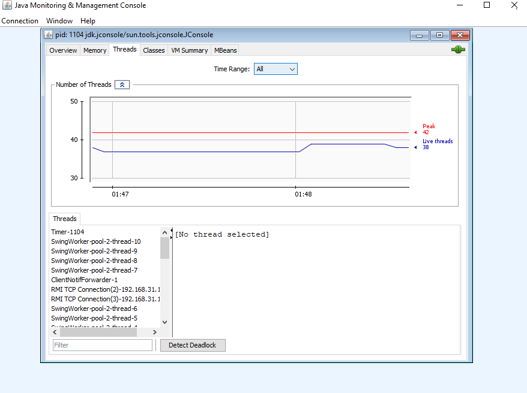

# Concurrency
Contains Java multithreading, concurrency projects, experiments and notes demonstrating common concurrency patterns, lock-free data structures, thread diagnostics and performance trade-offs.

[View on GitHub](.)

---
Table of contents
- [What this project does](#what-this-project-does)
- [Why this is useful (features & benefits)](#why-this-is-useful-features--benefits)
- [Quick start — run examples](#quick-start---run-examples)
- [Project layout (file-by-file topics)](#project-layout-file-by-file-topics)
- [Key comparisons (tables)](#key-comparisons-tables)
- [Examples & repository artifacts (images, dumps)](#examples--repository-artifacts-images-dumps)
- [Note on Readme ](#ReadMe--file-generation)

What this project does
- Title: Concurrency
- Short description: A collection of concise Java examples, experiments and notes covering threads, synchronization, locks, lock-free algorithms, thread-dumps/diagnostics, IO- vs CPU-bound threading models and virtual threads (Project Loom notes).
- Scope: runnable example classes, notes files, performance experiments and captured thread-dump artifacts.

Why this is useful — features & benefits
- Hands-on micro-examples to reproduce concurrency pitfalls (data races, deadlocks) and to learn remedies.
- Practical experiments to compare thread models (thread-per-task, thread pool, virtual threads).
- Lock-free and lock-based comparisons with sample implementations.
- Thread diagnostics: captured jstack/jcmd dumps and a JConsole screenshot to learn inspection techniques.
- Performance notes & metrics for tuning real workloads.

Quick start — run examples
Requirements
- JDK 11+ recommended. For virtual-thread examples, use a Loom-enabled JDK (JDK with virtual threads support).
- No build system required — most examples are standalone Java classes.

Compile & run a single example
- From repository root, compile:
  javac -d out $(find . -name "*.java")
- Run a main class (example):
  java -cp out threading_model_io_bound.ThreadPoolTask

Notes:
- Replace the package-qualified class name above with the target example (e.g., intro.ThreadBasics).
- For virtual threads, run with the JDK that supports them. Some examples are notes-only (no .java to compile).

Project layout — file-by-file topics
(Each entry: filename — short summary — important analysis / experiments)

concurrency_challenges/
- [AtomicData.java](concurrency_challenges/AtomicData.java)
  - Summary: Atomic primitives usage (AtomicInteger/AtomicReference).
  - Analysis:
    - Best for single-field atomic operations.
    - Lower overhead than synchronized for simple counters.
  - Experiments: micro-contended increments.

- [DataRaceExample.java](concurrency_challenges/DataRaceExample.java)
  - Summary: Reproduces data race and lost updates.
  - Analysis:
    - Demonstrates the need for volatile/atomic/synchronized.
  - Experiments: run many iterations to observe nondeterminism.

- [DeadLocks.java](concurrency_challenges/DeadLocks.java)
  - Summary: Intentional deadlock via opposite lock ordering.
  - Analysis:
    - Root cause: inconsistent lock order.
    - Avoidance: global lock ordering, tryLock with timeout, redesign.
  - Experiments: reproduce deadlock; inspect dumps in thread_dump/.

- [Metrics_Capture_Example.java](concurrency_challenges/Metrics_Capture_Example.java)
  - Summary: Emits simple runtime metrics during concurrent runs.
  - Analysis:
    - Useful baseline for throughput/latency comparisons.
  - Experiments: collect and extend with JMX/Prometheus if desired.

- [SyncronizationLock.java](concurrency_challenges/SyncronizationLock.java)
  - Summary: synchronized blocks/methods examples.
  - Analysis:
    - Ensures visibility and mutual exclusion.
    - Consider ReentrantLock or atomics when you need more control.

- [Volatile_CacheCoherence.java](concurrency_challenges/Volatile_CacheCoherence.java)
  - Summary: Demonstrates volatile visibility semantics.
  - Analysis:
    - volatile ensures visibility, not compound atomicity; use AtomicInteger for increments.

- [concurrency_challenges (notes)](concurrency_challenges/concurrency_challenges)
  - Summary: Consolidated conceptual notes on common concurrency pitfalls.

intro/
- [Multithread_hacker_example.java](intro/Multithread_hacker_example.java)
  - Summary: Beginner demo creating multiple threads.
  - Analysis:
    - Observe interleaving, scheduling and importance of join().

- [ParallelCalculation.java](intro/ParallelCalculation.java)
  - Summary: Splits CPU-bound work across threads.
  - Analysis:
    - CPU-bound tasks should target ~#cores threads; oversubscription hurts performance.

- [ThreadBasics.java](intro/ThreadBasics.java)
  - Summary: Thread lifecycle basics: start() vs run(), join() demonstration.

- [ThreadCoordination.java](intro/ThreadCoordination.java)
  - Summary: Demonstrates coordination primitives (wait/notify, barriers).
  - Analysis:
    - Guard waits with loops; prefer higher-level utilities such as CountDownLatch.

lockfree_algo/
- [CompareAndSet.java](lockfree_algo/CompareAndSet.java)
  - Summary: CAS semantics via Java Atomic classes.
  - Analysis:
    - Lock-free for single-word state, but must plan for ABA issues.
  - Experiments: throughput under contention vs lock-based counters.

- [LockFreeNeed](lockfree_algo/LockFreeNeed)
  - Summary: Notes on when lock-free data structures are useful.
  - Analysis:
    - Good for low-latency, high-concurrency single-field operations.

- [LockFreeStack_Comparison.java](lockfree_algo/LockFreeStack_Comparison.java)
  - Summary: Lock-free stack and lock-based stack comparison.
  - Analysis:
    - Watch ABA; consider AtomicStampedReference or versioning.

locks/
- [ConditionVariablesOnLock.java](locks/ConditionVariablesOnLock.java)
  - Summary: ReentrantLock + Condition example (await/signal).
  - Analysis:
    - Useful for multiple wait-sets and structured signaling.

- [ObjectSignalingOnLock.java](locks/ObjectSignalingOnLock.java)
  - Summary: wait/notify with intrinsic lock example.
  - Analysis:
    - Must guard wait with a loop for spurious wakeups.

- [ReadWriteReentrantLocks.java](locks/ReadWriteReentrantLocks.java)
  - Summary: ReadWriteLock demonstration for read-heavy workloads.

- [ReentrantLocks.java](locks/ReentrantLocks.java)
  - Summary: ReentrantLock usage with tryLock, fairness options.

- [tEST.java](locks/tEST.java)
  - Summary: Small exploratory code piece.

nonBlocking_call/
- [NettyInfo](nonBlocking_call/NettyInfo) — notes (placeholder)
- [VertexInfo](nonBlocking_call/VertexInfo) — notes (placeholder)
- [springWebFlux](nonBlocking_call/springWebFlux) — notes (placeholder)
  - Summary: Notes / placeholders for non-blocking frameworks (Netty, Vert.x, Spring WebFlux).
  - Analysis:
    - Non-blocking stacks scale well for many concurrent IO requests.

performance/
- [ImageProcessing_Optimization.java](performance/ImageProcessing_Optimization.java)
  - Summary: Partitioning image processing tasks across threads for CPU-bound work.

- [WebApi_Throughput_Opimization.java](performance/WebApi_Throughput_Opimization.java)
  - Summary: Examples and notes on tuning web API throughput.

- [performance_metrics.txt](performance/performance_metrics.txt)
  - Summary: Collected metrics / experiment logs — use as baseline.

resources/
- [MatrixMultiplication/](resources/MatrixMultiplication) (placeholder directory)
- [WebApiThroughput/](resources/WebApiThroughput) (placeholder directory)
- [imageProcessing/](resources/imageProcessing) (placeholder directory)
  - Summary: Data and example inputs (placeholders).

semaphore/
- [ProducerConsumerQueue.java](semaphore/ProducerConsumerQueue.java)
  - Summary: Producer-consumer implemented with semaphores.
  - Analysis:
    - Shows bounded-buffer coordination; BlockingQueue is often simpler in production.

- [SingleProducerConsumer.java](semaphore/SingleProducerConsumer.java)
  - Summary: Minimal single-producer single-consumer demo.

thread_dump/
- [JcmdThread.java](thread_dump/JcmdThread.java)
  - Summary: Notes/example for capturing thread dumps via jcmd.
  - Artifact: [jcmdThreadDump.txt](thread_dump/jcmdThreadDump.txt)

- [JconsoleThread.java](thread_dump/JconsoleThread.java)
  - Summary: JConsole usage notes and includes screenshot.
  - Image: [jconsoleThread.png](thread_dump/jconsoleThread.png)

- [JstackThread.java](thread_dump/JstackThread.java)
  - Summary: jstack usage notes.
  - Artifact: [jstackThreadDump.txt](thread_dump/jstackThreadDump.txt)

- [JvisualVmWorking.java](thread_dump/JvisualVmWorking.java)
  - Summary: VisualVM profiling and thread inspection notes.

threading_model_io_bound/
- [ThreadPoolTask.java](threading_model_io_bound/ThreadPoolTask.java)
  - Summary: Submits TASKS=10_000 to a fixed pool (size 1000) where each task sleeps 1s — simulates blocking IO.
  - Analysis:
    - Demonstrates the need to size pools for blocking workloads.
  - Example run:
    - javac -d out threading_model_io_bound/ThreadPoolTask.java
    - java -cp out threading_model_io_bound.ThreadPoolTask

- [Blocking_Nonloacking_Threads](threading_model_io_bound/Blocking_Nonloacking_Threads)
  - Summary: Conceptual article on IO-bound vs CPU-bound threading models and pros/cons.

- [ThreadperTaskModel.java](threading_model_io_bound/ThreadperTaskModel.java)
  - Summary: Creates 1000 threads (one per task) each sleeping — shows memory and scheduling pressure.

- [ThreadPoolContextSwitchOverhead.java](threading_model_io_bound/ThreadPoolContextSwitchOverhead.java)
  - Summary: Shows context switching overhead with nested submissions and many small blocking tasks.

virtual_thread/
- [ThreadPinning.java](virtual_thread/ThreadPinning.java)
  - Summary: Notes/demos about pinned/native vs virtual threads and implications.

- [VirtualThreadInfo](virtual_thread/VirtualThreadInfo) — notes
  - Summary: Benefits and caveats of virtual threads (Project Loom).

- [VirtualThreadNoContextSwitchOverhead.java](virtual_thread/VirtualThreadNoContextSwitchOverhead.java)
  - Summary: Demo showing virtual threads reduce context-switch overhead for blocking tasks.

- [VirtualThreadmpl.java](virtual_thread/VirtualThreadmpl.java)
  - Summary: Small virtual-thread helper/demo; check JDK compatibility.

Key comparisons (tables)

Lock-based vs Lock-free

| Aspect | Lock-based (synchronized/ReentrantLock) | Lock-free (CAS / Atomic) |
|---|---:|---|
| Ease of reasoning | Higher for coarse-grained ops | Lower — tricky for complex invariants |
| Blocking | May block under contention | Non-blocking (may retry) |
| Latency under contention | Can spike due to blocking | Retries can increase CPU but avoid OS blocking |
| Complexity | Lower for many problems | Higher (ABA, versioning) |
| Use-case | Multi-field invariants, simple correctness | Single-field low-latency updates |

Thread-per-task vs ThreadPool vs Virtual threads

| Aspect | Thread-per-task | ThreadPool (platform threads) | Virtual threads |
|---|---:|---:|---|
| Scalability for blocking IO | Poor (OOM risk) | Reasonable if sized properly | Excellent (lightweight) |
| Creation cost | High | Moderate | Very low |
| Context-switch cost | High at scale | Moderate (depends on load) | Low |
| Programming model | Simple | Requires pool management | Imperative code, minimal changes |
| Best for | Small number of concurrent tasks | Known concurrency bounds | Many concurrent blocking IO tasks |

Examples & repository artifacts (images, dumps)
- Images:
  - thread_dump/jconsoleThread.png (embedded above)
- Thread dumps / artifacts:
  - thread_dump/jcmdThreadDump.txt
  - thread_dump/jstackThreadDump.txt
- Performance logs:
  - performance/performance_metrics.txt

Note on Readme 
 - This readme is generated using github copilot using Github approved promts .